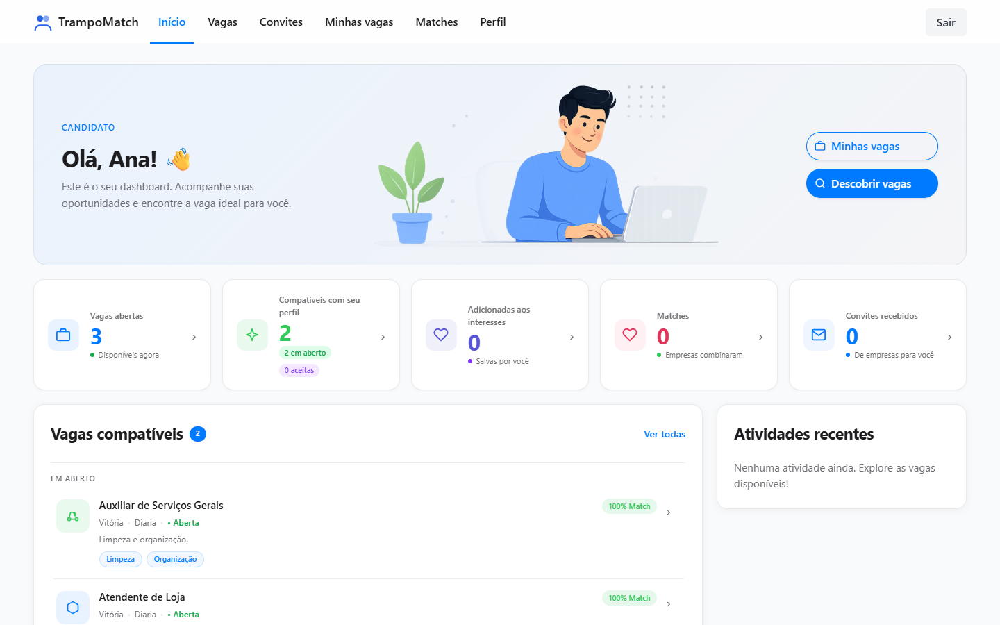
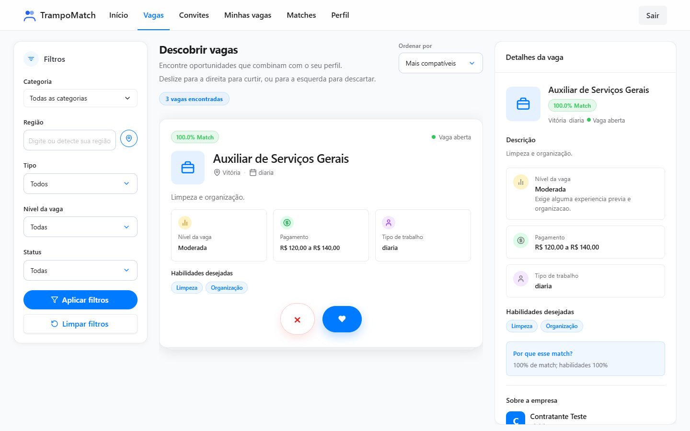
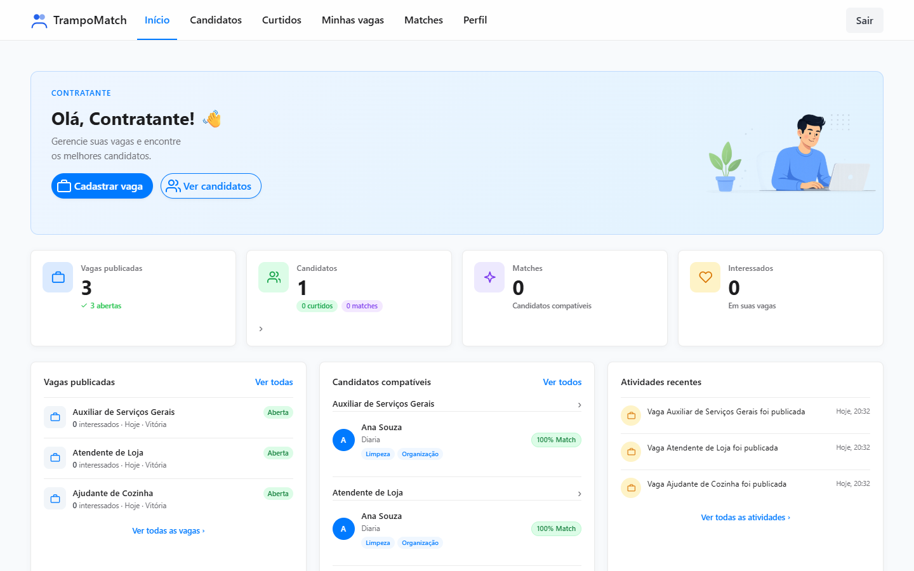

# TrampoMatch


Plataforma web que conecta candidatos a vagas locais por **compatibilidade ponderada** e **interesse mútuo**: o contato só é liberado quando candidato e contratante demonstram interesse na mesma vaga, no estilo "match".



## Destaques

- **Dois perfis**: candidato (descobre e curte vagas) e contratante (publica vagas e avalia candidatos).
- **Score de compatibilidade** com sinônimos de habilidades, correspondência aproximada e regras eliminatórias.
- **Match bilateral**: convites, recusas, descartes e histórico de matches.
- **Upload de currículo** com validação de tipo e tamanho.
- **Login tradicional ou Google OAuth** (opcional).
- **77 testes automatizados** com banco SQLite em memória.

## Telas

| Descobrir vagas | Painel do contratante |
| --- | --- |
|  |  |

<sub>Capturas geradas com dados fictícios.</sub>

## Algoritmo de compatibilidade

Implementado em [`trampomatch/services/compatibilidade.py`](trampomatch/services/compatibilidade.py).

| Critério | Peso |
| --- | --- |
| Habilidades | 80% |
| Região | 5% |
| Tipo de vaga | 5% |
| Experiência | 5% |
| Disponibilidade | 5% |

- Normalização de sinônimos de habilidades.
- Correspondência aproximada com [RapidFuzz](https://github.com/rapidfuzz/RapidFuzz).
- Clusters de cidades da Grande Vitória (ES).
- Critérios eliminatórios para região e turno incompatíveis.
- Limiar de **70%** para classificar uma vaga como compatível.

## Stack

| Camada | Tecnologias |
| --- | --- |
| Back-end | Python 3.12, Flask 3, SQLAlchemy, Flask-Login, Flask-WTF, Authlib |
| Front-end | Jinja2, Bulma, CSS customizado |
| Matching | RapidFuzz |
| Qualidade | Pytest, pytest-flask, Flake8 |

## Estrutura

```text
trampomatch/
├── models/        # Usuários, perfis, vagas, interesses e matches
├── services/      # Compatibilidade, candidatura, match e currículo
├── views/         # Blueprints: auth, candidato, contratante, vagas, main
├── forms/         # Formulários WTForms com validação
├── templates/     # Páginas Jinja2
└── static/        # CSS, imagens e mídia
tests/             # Testes de auth, perfis, vagas e compatibilidade
```

## Executar localmente

```bash
python -m venv .venv
source .venv/bin/activate        # Windows: .venv\Scripts\activate
pip install -e ".[dev,test]"
cp .env.example .env.dev         # Windows: copy .env.example .env.dev
flask --app app run --debug
```

Em `.env.dev`, troque `SECRET_KEY` por um valor aleatório. `GOOGLE_CLIENT_ID` e `GOOGLE_CLIENT_SECRET` só são necessários para o login com Google.

Para produção, defina `APP_CONFIG=production`, `SECRET_KEY` e `DATABASE_URL`. A aplicação não inicia em produção sem `SECRET_KEY`.

## Testes

```bash
pytest -q
flake8 trampomatch tests
```

## Equipe

Projeto final da disciplina **Programação Web Avançada** da Universidade Vila Velha (UVV), 2026.

- Gabriel Aguiar
- Arthur Prates Pessoti
- Leonardo Rosa dos Santos

Orientação: Prof. Wanderson Muniz de Santana.

## Status

Aprovado na apresentação acadêmica e apresentado à liderança de RH da UVV para avaliação como possível solução. A apresentação não representa adoção institucional.
